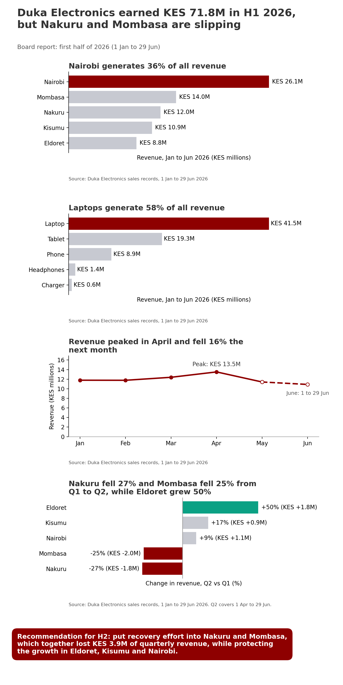

# Student Performance EDA and Duka Electronics Board Report

PLP Data Analytics, Week 4. This repository holds two engagements that show both halves of an analyst's job: finding the story in the data and telling it clearly.

| Engagement | Client | Question | Deliverable |
|---|---|---|---|
| 1. Student performance EDA | County Director of Education | Which learners are most at risk, and what is associated with better results? | `student_eda.ipynb` |
| 2. Duka Electronics board report | Duka Electronics board | Where should sales effort go in the second half of 2026? | `board_report.ipynb`, one-page report, dashboard |

## Repository contents

| Path | What it is |
|---|---|
| `generate_data.py` | Both dataset generators, unchanged: student performance (seed 55) and Duka Electronics (seed 2026) |
| `student_eda.ipynb` | Engagement 1: Structure, Univariate, Bivariate, Multivariate and Hypotheses, then Findings, Recommendations and Limitations |
| `board_report.ipynb` | Engagement 2: storyboard, chart makeover, story charts, one-page report and dashboard data export |
| `figures/` | EDA charts for Engagement 1, `before.png` and `after.png` from the chart makeover, and the Duka story charts |
| `reports/duka_board_report.png` | The one-page board report |
| `dashboard.md` | Public Looker Studio dashboard link and screenshots |
| `requirements.txt` | Python libraries used |

## How to run

1. Install the libraries: `pip install -r requirements.txt` (plus `jupyter` to open the notebooks).
2. Create the data: `python generate_data.py`. This writes `student_performance.csv` (1,200 students) and `duka_sales.csv` (1,000 orders).
3. Open `student_eda.ipynb` and `board_report.ipynb`, choose **Restart kernel and run all cells**. Charts are saved to `figures/` and `reports/`.

In Google Colab, `board_report.ipynb` downloads `generate_data.py` from this repository automatically.

## Engagement 1: County education office

**Data:** 1,200 students, one row per student, no dates. No missing values, no duplicates and every value in its valid range. **99 of 1,200 learners (8.2%) are At Risk** (average score below 60).

### Five key EDA insights

1. **Study hours are the strongest driver of scores.** Study hours correlate with average score at r = 0.70. The trend line shows about 2.1 more marks per extra weekly study hour (R² = 0.50). This is an association, not proof of cause.
2. **Risk is concentrated in low-attendance and low-study learners.** The At Risk share is 23.9% for learners attending under 70% of days against 2.6% above 85%, and 21.2% in the bottom study-hours quartile against 0.3% in the top quartile.
3. **Private-school students score 5.5 marks higher, and attendance and study time do not explain the gap.** It holds in every attendance band (5.0 to 6.6 marks) and every study quartile (3.5 to 7.8 marks). Only 1.5% of private-school learners are At Risk against 10.9% in public schools, and public schools hold 95% of all At Risk learners.
4. **County and gender are poor targeting variables.** County averages differ by only 2.1 marks and gender by 0.2. Nairobi has the highest At Risk share (9.2%), but all counties fall between 6.4% and 9.2% and the differences are consistent with chance (p = 0.92).
5. **A simple two-factor rule finds almost all At Risk learners.** Flagging learners with low attendance or bottom-quartile study hours covers 41% of students and captures 89% of all At Risk learners. The 59 learners with both risk factors are 4.9% of students, and 59% of them are At Risk.

### Recommendations

1. Target the programme by attendance (below 70%) and study time (under 2.9 hours a week), not by county, with first priority for the 59 learners who have both risk factors.
2. Prioritise public schools and run the programme as a measured pilot with a comparison group, so the effect can be shown before the budget is scaled up.

### Limitations

The data is observational and a single snapshot, so every result is an association. Household income, teacher-pupil ratios and prior attainment are missing, so the private-school gap cannot be attributed to the school itself. The trend line is valid only for the observed 0.2 to 23.3 study hours (it predicts 104 marks at 20 hours, which is impossible because marks are capped at 100). County groups have only 184 to 212 students.

## Engagement 2: Duka Electronics board report

**Data:** 1,000 orders from 1 January to 29 June 2026, total revenue KES 71,792,500. The data stops one day short of the end of June, so June is slightly understated.

**Story (Situation, Complication, Resolution):** Duka earned KES 71.8M in the first half and Nairobi contributes 36%. Revenue peaked in April and fell 16% in May, and the flat quarterly total hides big differences between branches: from Q1 to Q2 Nakuru fell 27% and Mombasa 25% while Eldoret grew 50%. We recommend a second-half recovery plan for Mombasa and Nakuru while protecting growth elsewhere.

**Chart makeover:** `figures/before.png` (default chart) and `figures/after.png` (redesigned), with each design change explained in `board_report.ipynb`.

### The one-page board report

### Board Summary

> Duka Electronics earned KES 71.8M in the first half of 2026. Nairobi is our engine, bringing in 36% of sales, and laptops are our best product, making up 58% of revenue. Laptops alone brought in KES 41.5M, more than twice the next product.
>
> But the steady total hides a problem. Sales peaked in April at KES 13.5M, then fell 16% in May. Comparing the second quarter with the first, Nakuru dropped 27% and Mombasa 25%, together losing KES 3.9M a quarter. Eldoret grew 50%, and Kisumu and Nairobi also grew.
>
> We recommend that second-half effort go into winning back customers in Mombasa and Nakuru. At the same time, protect the growth in Eldoret, Kisumu and Nairobi, and keep laptops well stocked, because they earn most of our income.
>
> One note: our data covers 1 January to 29 June, so June is one day short. All figures come from 1,000 orders.

## Dashboard

The live Looker Studio dashboard, with scorecards, a monthly trend, breakdowns by branch and product, and date and channel filters, is linked in [dashboard.md](dashboard.md).

## Notes

The datasets are synthetic and are created by `generate_data.py`.
